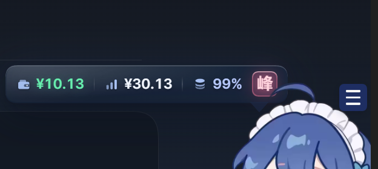

# dsh-whale-combo — 鲸鱼娘 · 合并数据卡

[](https://www.npmjs.com/package/dsh-whale-combo)
[](LICENSE)
[](https://github.com/Guzi2005/dsh-whale-combo)

一个 [DeepSeek Harness](https://github.com/deepseek-ai)（DSH）Web 插件：在右下角 **dsh-whale-widget**
的鲸鱼娘旁边，显示一张**深色毛玻璃**横向状态卡（余额 / 今日 / 缓存命中 / 峰·谷），并在每次计费时从她
头顶向上发射**深蓝色扣费弹幕**。界面在 `shell.overlay` 浮层里，原生 React 渲染，可在插件页启用 / 停用 / 卸载。



> 截图来自实际运行中的 DSH 客户端：鲸鱼娘头顶的深蓝扣费弹幕。

## 特性

- **毛玻璃拟态卡片**：`backdrop-filter` 模糊 + 半透明底色（约 26%）+ 顶部高光 / 内阴影 / 外投影，
  不画整体描边（避免小尾巴接缝出现拼接线），尾巴是独立玻璃质地。
- **三组极简图标 + 统一字号数值**：
  - 钱包 `¥余额`（薄荷绿）
  - 柱状图 `¥今日`（白）
  - 数据库 `缓存命中率`（浅蓝）
  - 右侧 **峰 / 谷** 玻璃徽章：峰＝红字红底，谷＝绿字绿底（同色系），悬停有北京时间口径说明。
  - 「本轮消耗」收在整卡的悬停提示里，不占卡面位置。
- **扣费弹幕**：
  - 深蓝色（未命中的一条为灰色），金额 21px / 未命中 25px、标签 13px、字重 900；
  - 从鲸鱼娘头顶向上发射，**队列发送、互不重叠**，右对齐且「−」号成列；
  - 发射沿用 `cubic-bezier(.2,.72,.3,1)` 的「弹射」缓动，出现时从小到大；
  - **每条扣费事件只发一次**：按扣费事件流的 `seq` 游标增量读取，不回放、不轮播。
- **不双份界面**：默认隐藏 damage-pulse 自带的悬浮卡，`Ctrl+Alt+D` 可临时显示。
- **稳定定位**：卡片锚定在鲸鱼娘头部右上方（尾巴尖靠近她的头）；使用冻结锚点，鲸鱼娘的呼吸/浮动
  不会带着卡片抖动，只有拖动她或缩放窗口才重新锚定。


## 交互

| 操作 | 效果 |
|---|---|
| 左键点击鲸鱼娘 | 开 / 关合并气泡 |
| 点击气泡本身 | 立即刷新数据 |
| 右键气泡 / `Esc` / 点空白处 | 关闭气泡 |
| `Ctrl+Alt+D` | 临时显示 / 隐藏 damage-pulse 原来的悬浮卡 |
| 鲸鱼娘右上角 ☰ | 仍是 `dsh-whale-widget` 自己的菜单（角色、大小、音效、吸附…） |

## 依赖

本插件是**界面层**：角色与数据来自另外两个插件，需一并安装（本插件不包含它们的任何源码或素材）。

| 插件 | 用途 | 缺失时 |
|---|---|---|
| [`dsh-whale-widget`](https://github.com/MeteorNOX/DeepSeek-Balance-Whale-Widget) | 鲸鱼娘角色本体、`.dshwv-img` 点击目标、`/dsh-whale/*` 数据 | 退化为右下角 `¥` 小圆钮开合气泡 |
| [`dsh-damage-pulse`](https://github.com/wssfk12138/dsh-damage-pulse) | `/api/token-monitor/balance`、`today-spend`、`usage-summary`、`charge-events` | 余额 / 今日 / 缓存 / 弹幕显示 `--`，峰谷仍按北京时间本地计算 |

## 数据来源（合并规则）

| 字段 | 主来源 | 回退 |
|---|---|---|
| 余额 | damage-pulse `GET /api/token-monitor/balance?provider=deepseek-account` | whale-widget `/dsh-whale/balance.json` |
| 今日消费 | damage-pulse `GET /api/token-monitor/today-spend` | whale-widget `todayUsage` |
| 本轮消费 | whale-widget `/dsh-whale/last-turn.json` | 最近一条扣费事件金额 |
| 缓存命中率 | damage-pulse `GET /api/token-monitor/usage-summary?range=today` | `--` |
| 峰 / 谷 | whale-widget `balance.json.isPeak` | 本地北京时间计算（工作日 9–12、14–18） |
| 弹幕 | damage-pulse `GET /api/token-monitor/charge-events?since=<seq>`（1s 增量轮询） | — |

所有请求都是同源只读接口，不新增外部网络调用。

## 安装

先装依赖插件，再装本插件：

```bash
# 1) 依赖（如果还没装）
dsh plugin --profile <profile> add dsh-whale-widget dsh-damage-pulse

# 2) 本插件（npm）
dsh plugin --profile <profile> add dsh-whale-combo
```

然后刷新页面 / 重开客户端。

也可以从源码 / 本地目录安装：

```bash
git clone https://github.com/Guzi2005/dsh-whale-combo.git
dsh plugin --profile <profile> add link:<clone 后的绝对路径>
```

或者在 **设置 → 插件 → 安装本地包** 里选择本目录。

卸载：Plugin Manager 移除本 bundle 即可。

## 实现

| 文件 | 作用 |
|---|---|
| `index.js` | Host 半身：只拥有插件行身份，无副作用 |
| `client.js` | 浏览器半身：注册到 `shell.overlay`，渲染卡片 / 弹幕 / 兜底小圆钮 |
| `cordis.patch.yml` | bundle patch：插入 Host 行 |
| `locale/{zh,en}.json` | 插件页标题 / 描述 |
| `icon.png` | 插件图标（448×448 PNG，216 KB，随包分发） |

浏览器半身是手写的 `window.__ModuleLoader__` 模块，不需要构建步骤，只依赖 shell 自带的 `react`。

集成契约：鲸鱼角色节点选择器为 `.dshwv-root .dshwv-img`（`dsh-whale-widget` 0.4.x）。
若上游大版本改动 DOM，只需改 `client.js` 里的 `WHALE_SELECTOR`。

## 说明与限制

- 卡片保持深色毛玻璃与固定配色（按设计稿定制，不使用主题 token）。
- 卡片 `z-index` 高于鲸鱼娘（10001），所以不会被她的头发盖住；弹幕在最上层（10002）。
- 视觉在运行中的 DSH 客户端里截图核对过；不同窗口尺寸下的位置由锚点公式自动计算。

## 致谢

本插件的「鲸鱼娘」与「精确计费数据」分别来自下面两个同样以 DSH 插件形式存在的第三方项目。
它们各自保留完整版权与许可，**本仓库不包含它们的源码或美术素材**：

- **[dsh-whale-widget](https://github.com/MeteorNOX/DeepSeek-Balance-Whale-Widget)** — 鲸鱼娘角色、☰ 菜单、
  `/dsh-whale/*` 数据接口。代码 MIT；`assets/` 下的美术素材按原样随插件分发、**不适用 MIT、不授予再许可**，
  因此本插件只通过它的 DOM 契约（`.dshwv-root .dshwv-img`）与 HTTP 路由协作，不复制任何素材。
- **[dsh-damage-pulse](https://github.com/wssfk12138/dsh-damage-pulse)** — 余额 / 今日消费 / 缓存命中率 /
  扣费事件流，以及「缓存感知」的计费口径。

感谢两位作者的出色工作 🐋

## License

[MIT](LICENSE)
